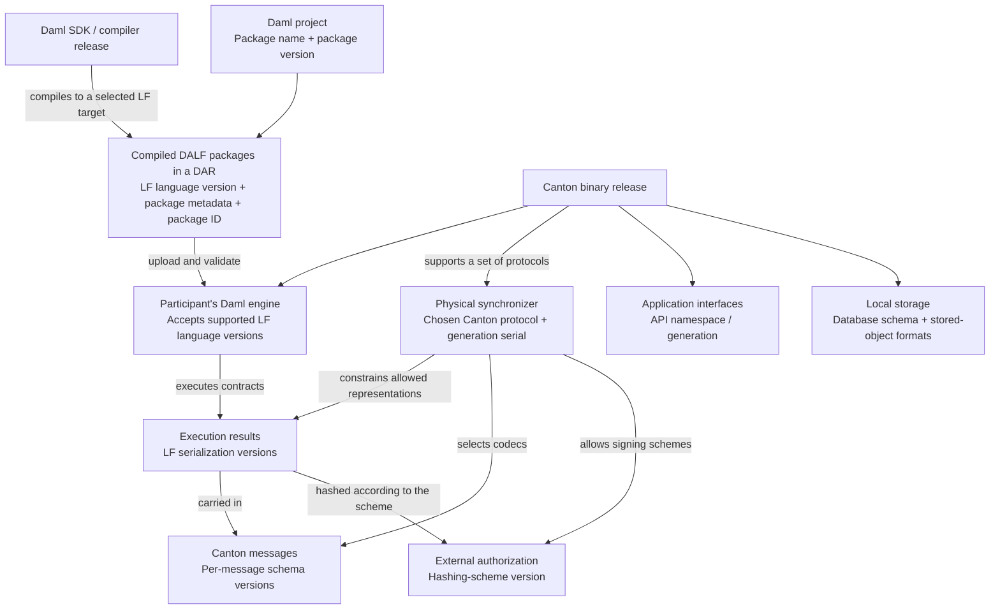

**Canton and Daml versioning**

Canton has several version systems because it connects several different kinds of entities: development tools, compiled smart-contract packages, applications, participant nodes, synchronizers, messages, cryptographic commitments, and databases. Each version describes a particular entity and a particular compatibility boundary.

The central question is therefore **“What does this version belong to?”** A Canton release such as `3.5.x`, Canton protocol `35`, Daml-LF language version `2.3`, Ledger API namespace `v2`, and protobuf schema `v30` can all occur in the same system. Their numbers do not need to match.

This explanation describes the versioning model in general. Concrete numbers are examples, including examples from established implementations; they are not a statement about the latest release or the protocols supported by a particular deployment. Supported versions, defaults, and experimental feature gates must be checked for the binary and network being used.

**The main entities and the role of their versions are shown below.** A participant executes smart contracts and exposes application APIs. A synchronizer provides the infrastructure through which participants coordinate transactions; its sequencers order messages and its mediators coordinate confirmation. These roles explain why application APIs, execution formats, and the Canton protocol have separate versions.

| Entity | Its role | What its version defines | Example | Who selects or defines it? |
|---|---|---|---|---|
| **Canton software distribution / binary** | Implements participant, sequencer, mediator, console, and other Canton functionality | The released implementation and its supported capabilities, APIs, configuration, protocols, and storage migrations | `3.5.2`, `3.6.0-SNAPSHOT` | Release/build process; operator selects the installed binary |
| **Canton protocol** | Defines how Canton nodes interact through a synchronizer | Shared message semantics, validation rules, behavior, and permitted wire formats | `34`, `35`, `dev` | Canton protocol definitions; synchronizer selects a supported protocol at initialization |
| **Physical synchronizer** | A particular incarnation of the infrastructure behind a logical synchronizer | Its protocol version defines its interaction rules; its separate serial identifies its physical generation | Logical ID followed by `::35-2` | Synchronizer operators and upgrade coordination |
| **Daml SDK / compiler toolchain** | Compiles Daml source, supplies libraries, runs scripts, and generates bindings | Which implementation of the development tools and associated artifacts is used | `3.x.y`, a dated snapshot | SDK release process; project or developer selects the toolchain |
| **Daml-LF language** | The compiled smart-contract language interpreted by the participant’s Daml engine | Available language constructs, built-ins, semantics, and package representation | `2.2`, `2.3`, `2.dev` | LF specification and implementation; compiler target chooses the package’s LF version |
| **LF archive payload** | Encodes an LF package inside a DALF | Carries the LF major/minor designation and a separate archive patch field | LF `2.3`, archive patch `0` | Archive format and producer; decoder controls what it accepts |
| **Daml application or library package** | Contains templates, choices, interfaces, data types, or helper code | The package’s revision within a named application/library lineage; orders upgrade comparisons | `asset-model`, version `1.4.0` | Package author, normally through `daml.yaml` |
| **DAR container / manifest** | Bundles a main DALF package and its dependencies | The manifest format; also records the producing SDK as provenance | `Manifest-Version: 1.0`, `Sdk-Version: ...` | Packaging tool and container format |
| **LF transactions, nodes, versioned values, and fat contract instances** | Represent execution results and contract data | The serialization specification used to encode those objects and the features their representation supports | Serialization `V1`, `V2`, `VDev` | LF runtime/serialization rules; Canton protocol constrains what can be used |
| **A Canton message or stored object type** | Carries protocol data or persists a local object | Its own protobuf or JSON schema and codec history | `ProtoVersion(30)`, schema package `v31` | The type’s schema definitions and versioning table |
| **A versioned-message wrapper** | Carries encoded bytes plus a payload-schema number | The wrapper’s own schema is separate from the embedded message’s version | Wrapper package `version.v1`, payload `version = 31` | Generic wrapper schema; message codec supplies the payload version |
| **Externally signed / prepared transaction hash** | Lets an external party authorize an interpreted transaction and its metadata | Exactly how the transaction and metadata are encoded and combined before hashing | Hashing scheme `V2`, `V3` | Hash specification; signer and participant must use an allowed, matching scheme |
| **Contract ID and authentication data** | Identifies a contract and lets Canton verify the integrity of its identity and contents | Contract-ID layout, Canton authentication suffix, associated hashing method, and authentication-data representation | LF contract-ID `V1`; Canton suffix `V12` | LF and Canton identifier/authentication specifications |
| **Application-facing API** | Lets applications submit commands, read ledger state, and administer nodes | An API namespace/generation or schema; a separate version-service string identifies the implementing release | Ledger API `v2`, JSON `/v2`, Admin API `v30` | API definitions; application selects the interface it uses |
| **Node database schema** | Stores a node’s durable state and indexes | Which table-layout and data migrations have been applied | Flyway migration `5.0` or `6.5` | Released migration files; operator or startup policy applies them |
| **Driver or engine-extension interface** | Connects Canton to a sequencer backend, KMS, or external engine service | The interface contract the implementation must satisfy | Driver API `1`; extension path `v1` | Interface owner and implementation; node configuration selects the implementation |

Some entries contain several related versions. For example, a contract ID has both an LF layout and a Canton authentication scheme. An API has a namespace generation and an implementing software release. Keeping these layers explicit prevents the most common misunderstandings.



The arrows describe compatibility relationships and selection rules. They do not imply that the connected entities have equal version numbers.

**A software release identifies an implementation.** Canton models its release as a major, minor, patch, and optional suffix. The stated release policy uses semantic versioning: major releases can introduce breaking changes, while minor and patch releases are intended to preserve the relevant public compatibility guarantees. The policy covers such things as Ledger API behavior, configuration, command-line arguments, machine-readable errors, storage continuity, and protocol interoperability. Console commands have documented exceptions with migration requirements.

A suffix such as `-rc3` denotes a release candidate. A snapshot suffix denotes a development build and can contain a date, build identifiers, and a commit identifier. These suffixes distinguish software artifacts; they do not select an LF language version or a Canton protocol.

For example, two patch releases can implement the same protocol and use the same schemas while differing in a performance fix. A newer binary can also implement several protocols, allowing its operator to upgrade the software while continuing to use an existing synchronizer.

Compatibility policy and actual supported-version lists must both be considered. **Do not infer protocol interoperability merely because two binaries have the same major release number.** The decisive test is whether each supports the protocol actually used on the connection. Release notes and the release-to-protocol mapping describe the supported upgrade path.

**The Canton protocol versions shared interaction rules.** Unlike a release version, a modern protocol version is an integer or the special development designation `dev`. It covers the semantics of communication as well as the representations permitted on the wire. Participants, sequencers, and mediators must agree on the protocol of the physical synchronizer through which they interact.

A physical synchronizer uses one selected protocol. A participant can connect to several synchronizers and speak a different supported protocol on each connection. The participant advertises a set of supported protocols; it does not impose its latest protocol on every synchronizer.

For an ordinary stable connection, the basic compatibility rule is:

```text
synchronizer protocol belongs to the participant's enabled supported set
and
synchronizer protocol meets the participant's configured minimum
```

For example, a participant supporting `{34, 35}` can connect to either protocol, unless its configured minimum excludes `34`. Merely supporting a higher number does not establish support for every historical lower number: the supported set matters.

Protocol versions also have lifecycle statuses. Stable versions have released compatibility expectations. Beta and alpha versions are previews with explicit enabling and compatibility rules. `dev` is a moving development protocol. Deprecated means recognized but discouraged; deleted means removed from normal support. A numbered alpha version and `dev` are distinct gates. Experimental handshakes can impose stricter requirements, including matching binary versions.

**A physical generation identifies infrastructure, independently of the protocol.** Canton distinguishes a stable logical synchronizer identity from a physical incarnation. A physical synchronizer identifier combines the logical ID, its protocol, and a serial, for example:

```text
payments::<namespace>::35-2
                       │  │
                       │  └─ physical generation serial
                       └──── Canton protocol
```

A physical synchronizer's protocol is fixed at initialization. A logical synchronizer upgrade can introduce a successor physical synchronizer with a new serial and possibly a new protocol while preserving the logical identity. Thus, replacing binaries, advancing the physical generation, and changing the protocol are separate actions. The [logical synchronizer upgrade documentation](https://docs.canton.network/global-synchronizer/production-operations/logical-synchronizer-upgrade) explicitly treats successor serial and protocol as separate parameters.

**Daml-LF versions the language of compiled packages.** Daml is the source language; Daml-LF is the compiled language evaluated by the participant's engine. A compiler release determines which source features it understands and which LF targets it can produce. An LF version determines the available compiled constructs, built-ins, language semantics, and package representation. The [compiler documentation](https://docs.canton.network/sdks-tools/development-tools/daml-compiler) describes this compilation and packaging pipeline.

An LF major/minor designation such as `2.2` is independent of a compiler release such as `3.x.y`. A newer compiler can produce an older LF target, and different compiler releases can produce packages in the same LF language version. Selecting an older target can preserve runtime compatibility, but also limits which features the package can use.

Stable LF versions use numeric minor versions. Staging versions can be spelled as release-candidate revisions, for example `2.3-rc1`; some toolchain interfaces use the corresponding `2.3-staging` spelling. `2.dev` identifies the development language. **An LF staging revision versions the staging language/format; it is unrelated to the SDK's own release-candidate number.**

The LF archive also has a patch field. This is part of the encoded archive payload, separate from the major/minor `LanguageVersion` model. Implementations can distinguish executable decoding from schema inspection: for example, normal decoding can require patch `0` while schema inspection tolerates a future patch. A present field is not a guarantee that arbitrary patch values can be executed.

An implementation can retain definitions or readers for historical LF versions without accepting them as execution targets. The participant engine's allowed-language list is a separate policy. A DAR can also contain dependencies compiled to different LF versions. Each package must satisfy the relevant reader, dependency, validation, and execution rules.

**The Daml SDK versions the development tools and their published artifacts.** A project's `sdk-version` selects a toolchain; it does not set the application's version or the LF language target. The SDK can bundle a compiler, libraries, a script runner, generators, and a Canton runtime for development. These artifacts have release/build identifiers.

The Daml assistant additionally distinguishes a public release requested by the user from an internal SDK build version. They can coincide, or a resolved release can contain both numbers. The assistant itself has a version too. Maven, npm, and GHC/package artifacts need their own usable version strings; the build can derive them from the SDK release, including a numeric form for package systems that do not accept the original suffix.

Modern DPM components have versioned artifacts, typically addressed through OCI tags or digests. Their component descriptors also have an `apiVersion`, such as `digitalasset.com/v1`, which describes the descriptor schema. The DPM executable release, a component artifact tag, and the component-descriptor schema are separate identifiers.

There is no universal requirement that SDK and Canton release strings be identical. What matters is the compatibility of the generated LF packages and required runtime features, along with the interfaces used by tools such as the script runner. The network's [compatible SDK installation guide](https://docs.canton.network/global-synchronizer/understand/installing-daml-sdk) explicitly says an exact SDK match is unnecessary and describes compatibility with older SDK-produced DARs.

**A package version versions your application or library.** Consider:

```yaml
sdk-version: 3.x.y       # Illustrative toolchain release; replace with a real version
name: asset-model       # Package lineage
version: 1.4.0          # Application/library revision
build-options:
  - --target=2.2        # LF language target
```

These settings control different entities. The package's name and version become LF metadata. For upgradeable packages, the name identifies a lineage and the version orders its revisions. Canton compares compatible revisions as part of its package-management and vetting workflows.

The runtime package-version type uses numeric segments separated by dots. It is not the full SemVer grammar: versions such as `1.4.0` are valid, while a suffix such as `1.4.0-beta` is not supported by that type. Increasing a package's apparent major version does not grant permission to make an incompatible smart-contract upgrade. Compatibility is determined by upgrade rules, not by the author's choice of digits. The [smart contract upgrading reference](https://docs.canton.network/appdev/deep-dives/smart-contract-upgrading-reference) explains package comparisons and allowed structural changes.

A package ID answers a different question: **which exact encoded package is this?** It is a content hash, not an ordered version. A changed payload has a changed ID. A template or choice normally derives its identity from the defining package and its qualified name; it does not have an additional independent revision counter.

Uploading a new package does not rewrite all existing contracts. Compatible definitions can be used with existing contracts under smart-contract upgrading, and several revisions can coexist. Selection depends on concrete package references, preferences, vetting, and the particular operation; it is not a universal rule to execute the numerically newest package. See [package selection](https://docs.canton.network/appdev/modules/m6-package-selection).

A DAR is a container of packages. Its manifest has a format version and records the producer's SDK version. Those are container/provenance fields. Each contained DALF still has its own package metadata, package ID, and LF language version. The manifest's SDK number does not demand that a participant run that exact SDK.

**LF serialization versions the execution data, separately from the language.** Executing compiled code produces transactions, action nodes, values, and contract instances. Those objects have representation requirements of their own. The LF serialization specification versions their encoding and the features those encodings support.

A historically important example is:

| Internal serialization version | Encoded spelling in the relevant implementation | Meaning |
|---|---|---|
| `V1` | `"2.1"` | An execution-data serialization generation; the old spelling was retained for compatibility |
| `V2` | `"2"` | A later generation, including newer contract-key representations |
| `VDev` | `"dev"` | Development execution-data features |

**Serialization `"2.1"` is not the LF language version `2.1`.** The string is ambiguous unless you know which field or type it belongs to. Likewise, serialization `V2` is not simply a label for every package in LF major version 2.

Nodes and other nested data can carry serialization versions, and a transaction's overall version is derived from its contents under runtime rules. Canton maps serialization requirements to minimum protocol requirements. For example, a protocol generation can allow serialization `V1`, while a later protocol adds `V2`.

This creates two different compatibility questions: can the participant load and execute the package, and can the selected synchronizer carry and validate the resulting transaction? A package upload alone does not establish that every synchronizer connected to the participant can process every transaction the package can produce.

**Each Canton message type versions its own schema.** Names such as `v30`, `v31`, `toProtoV30`, and `ProtoVersion(30)` identify a protobuf schema or codec. They do not identify the synchronizer's protocol. A protocol uses many message types, and those types evolve at different times.

For example, consider a message with this codec table:

| Protocol range | Message schema | Representative protocol |
|---|---|---|
| `34 ≤ protocol < 35` | Protobuf `30` | `34` |
| `protocol ≥ 35`, until a later codec transition | Protobuf `31` | `35` |

Another message that never changed at protocol `35` can continue using protobuf `30` for both protocols. A protocol upgrade therefore does not require every protobuf package number to advance.

`RepresentativeProtocolVersion[T]` is an implementation device for this relationship. It represents a group of protocols that use the same codec for type `T`, usually by the protocol at the start of that group. It is neither an extra network protocol nor the node's active protocol. It is specific to its message type and must not be reused as another type's representative.

Versioning tables select codecs for serialization. On network input, the version machinery checks that the decoded representation agrees with the expected protocol. Trusted stored-data reads have different entry points. Signed objects may retain their original bytes to preserve the exact evidence covered by a signature.

The generic `UntypedVersionedMessage` wrapper itself has a schema, for example package `version.v1`, and its payload carries another number:

```text
Wrapper schema v1
    version = 31                 # This message's payload schema
    data = <message bytes>

The payload codec may have been selected for Canton protocol 35.
```

JSON versioned wrappers follow the same general distinction. Their embedded format version is separate from the HTTP JSON API's `/v2` route generation. Marker traits such as stable, alpha, and storage protobuf markers describe permitted use or stability; they do not create another independent numeric sequence.

**A hashing-scheme version defines what an external party signs.** An externally signed transaction is authorized by a digest of its interpreted contents and relevant metadata. The signer and participant must agree on the exact encoding, included fields, ordering, and hash construction. A hashing-scheme version defines that agreement.

This is different from choosing a digest algorithm such as SHA-256. Two hashing schemes can use SHA-256 but include different data or encode it differently, yielding different digests.

Protocols allow particular hashing schemes, and those schemes support particular LF serialization features. For example, one scheme can handle serialization `V1`, while a newer scheme is needed for `V2`. A synchronizer can allow both schemes, but a transaction requiring the newer representation still cannot use the older scheme. Development schemes can add experimental data such as external-call results.

Lower-level LF hashing also has encoding versions: legacy value hashing, upgrade-friendly value hashing, typed-normal-form hashing, node hashing, and contract-key hash constructions. These are separate from the interactive-submission hashing-scheme number. Their role is to preserve the interpretation of stored identifiers and cryptographic commitments as data models evolve.

**Contract-ID versions define identity and authentication formats.** LF defines contract-ID layout families. Canton adds authentication conventions within them. An LF contract-ID family such as `V1` can contain several Canton suffix schemes, for example `V10`, `V11`, and `V12`, with prefixes such as `ca10`, `ca11`, and `ca12`.

Conceptually, one such identifier looks like:

```text
LF family prefix | discriminator | Canton scheme prefix | authentication hash
```

The outer LF layout tells the reader how to split the identifier. The Canton scheme tells it how the authentication suffix and contract hash should be interpreted. Associated contract-authentication data also has representations tied to these schemes, with its own protobuf encoding.

Recognizing an older or newer contract-ID format does not mean the runtime creates that format by default. Creation policy can depend on the Canton protocol, while readers retain support for other formats. A contract-ID version is independent of the LF language version, application package revision, and Canton release.

**An API generation defines an application interface.** Ledger API `v2`, JSON routes under `/v2`, Admin API schema packages such as `v30`, and prepared-transaction subpackages such as `transaction.v1` belong to different interface/schema layers. A single Canton release can expose all of them.

The Ledger API version service reports an additional release string. In the inspected implementation, it returns the Canton binary's `BuildInfo.version`. Therefore an endpoint in namespace `com.daml.ledger.api.v2` can report a release such as `3.5.2`. It also returns a feature descriptor with supported capabilities and limits; see the [version service description](https://docs.canton.network/sdks-tools/api-reference/ledger-api-services).

An HTTP API generation can change request shapes and endpoint organization independently of the synchronizer protocol. For example, JSON API V2 mirrors the gRPC API more closely than JSON API V1. That migration is documented in the [JSON API migration guide](https://docs.canton.network/sdks-tools/api-reference/json-ledger-api-migration-to-v2).

**Database schema versions define local persistence requirements.** Flyway migration identifiers describe an ordered history of table-layout and data transformations. A migration named `V5_0__...sql` has migration version `5.0`; that number is not a Canton release or network protocol. Applied history and checksums establish the database's migration state. Repeatable migrations use `R__...` and are controlled by checksum changes rather than a numbered step.

Stored objects can additionally contain protobuf, LF serialization, or other format versions. A binary must understand both the database layout and the bytes stored inside it. Development migrations can have different continuity guarantees from released migrations.

`ReleaseProtocolVersion` is a related code-level distinction: it wraps a protocol used as a node-wide format-selection context, typically for local data not tied to one synchronizer. Despite its name, it is not the software release's `major.minor.patch` string and does not mean that every connection uses that protocol.

Installing a new binary and applying its schema migrations are separate operations, as explained in the [Canton node upgrade guide](https://docs.canton.network/global-synchronizer/production-operations/upgrade-canton-nodes). Upgrade compatibility also does not imply that an older binary can safely reopen a migrated database.

**Smaller formats and object revisions complete the picture.** Some numbers select a data format; others track changing state. Their purpose should remain explicit.

| Entity or field | Kind of version | Role |
|---|---|---|
| Sequencer driver API / KMS driver API | Interface version | Matches the interface implemented by a plugin; separate from the plugin's own release |
| Engine extension's configured version path | External API version | Selects the extension service API; independent of Canton release and protocol |
| Daml Script internal command payload | Per-command format version | Lets the runner interpret requests emitted by a compiled script library; different commands can evolve independently |
| IDE ledger protocol setting | Protocol behavior selector | Selects the Canton behavior a local test ledger imitates, including key/rollback behavior; it does not upgrade a real synchronizer |
| Reassignment ID | Identifier format version | Versions the identifier's byte/hash construction; independent of a contract's reassignment counter |
| Topology transaction serial | Object revision counter | Orders successive updates of a topology mapping with the same unique key and prevents replay |
| Physical synchronizer serial | Infrastructure generation counter | Distinguishes successive physical incarnations of one logical synchronizer |
| User/party metadata `resource_version` | Opaque object revision | Detects concurrent changes in a read-modify-write operation; clients return it unchanged |
| ACS/update pagination and continuation tokens | Internal format/checksum version | Allows token parsing and validation; clients should treat tokens as opaque |
| Certain stored binary representations | Internal encoding version | Prefixes a specialized representation, such as an encoded integer array |
| Internal state versions | State revision | Distinguishes successive in-memory or persisted states using counters/timestamps |
| Crypto key/signature format and algorithm selectors | Format or algorithm identifier | Tells readers how to interpret key/signature bytes; these are alternatives, not necessarily an ordered release sequence |
| TLS version | Transport protocol version | Controls the secure transport; independent of the Canton transaction protocol |
| OpenAPI/AsyncAPI or component descriptor schema | Description format version | Defines how a machine-readable interface description is represented; separate from the described application's release |
| Java, PostgreSQL, Scala, build tools, libraries, images | Dependency/runtime/artifact release | Establishes build and operating-environment compatibility rather than ledger rules |

In the wider Canton Network, Splice, wallet SDKs, applications, container images, deployment charts, and their APIs also have independent release/version schemes. A validator deployment combines components; it is not described completely by one Canton version. Network-specific migration identifiers and deployment configuration are additional operational state, rather than alternative names for the Canton protocol.

**A complete example shows how the independent versions fit together.** Imagine an `asset-model` package at version `1.4.0`, compiled to an LF target that supports a required feature. A participant loads it, interprets a command, and submits the resulting externally signed transaction through a compatible synchronizer.

The following numbers illustrate a combination; they do not assert that every release with a similar name supports it.

| Label | Illustrative value | Question it answers |
|---|---|---|
| SDK/compiler release | A compatible `3.x.y` | Which toolchain built the package? |
| Package name/version | `asset-model`, `1.4.0` | Which business-model lineage and revision? |
| Package ID | Content hash | Which exact compiled package? |
| LF language | `2.3` | Which compiled language/features? |
| Archive patch | `0` | Which archive patch representation? |
| Canton binary release | A compatible `3.5.x` or later release | Which node implementation and capabilities? |
| Ledger API namespace | `v2` | Which application-facing API generation? |
| Synchronizer protocol | `35` | Which interaction rules apply? |
| Physical generation | Serial `2` | Which incarnation of the synchronizer? |
| LF serialization | `V2`, encoded `"2"` in this example | Which execution-data representation? |
| External signing scheme | `V3` | How is the authorized digest computed? |
| A particular message schema | Protobuf `31` | How are this message's bytes interpreted? |
| Contract-ID scheme | LF `V1` with a Canton suffix scheme | How is the contract identified/authenticated? |
| Database migration state | Applied migration history | Which local persistence layout? |

Changing the application package from `1.4.0` to `1.5.0` changes its business-model revision. Installing a new participant binary changes the implementation. Switching to a successor physical synchronizer changes infrastructure and potentially its protocol. None of these actions automatically changes every other row.

To assess compatibility, follow the actual boundaries: **toolchain to LF package; package to participant engine; execution data to synchronizer protocol; transaction to signing scheme; application to API; and binary to local storage.** There is no single version-number comparison that replaces all of these checks.

**The code locations below are a reference map.** They identify the entities' definitions and compatibility machinery, rather than freezing their supported values. Paths are relative to the Canton repository; `../daml` refers to the sibling Daml SDK checkout.

| Version family | Principal definitions / enforcement |
|---|---|
| Canton release | [VERSION](VERSION), [version.sbt](version.sbt), [CantonVersion.scala](community/base/src/main/scala/com/digitalasset/canton/version/CantonVersion.scala), [BuildCommon.scala](project/BuildCommon.scala), [compatibility policy](contributing/backwards-incompatible-changes.md) |
| Canton protocol and lifecycle | [ProtocolVersion.scala](community/base/src/main/scala/com/digitalasset/canton/version/ProtocolVersion.scala), [release/protocol table](community/common/src/main/scala/com/digitalasset/canton/version/ReleaseVersionToProtocolVersions.scala), [compatibility checks](community/common/src/main/scala/com/digitalasset/canton/version/ProtocolVersionCompatibility.scala), [handshake checks](community/synchronizer/src/main/scala/com/digitalasset/canton/synchronizer/service/HandshakeValidator.scala) |
| Physical synchronizer generation | [Member.scala](community/base/src/main/scala/com/digitalasset/canton/topology/Member.scala) |
| SDK/build/artifact versions | [DamlVersions.scala](project/project/DamlVersions.scala), [SDK Canton pin](../daml/sdk/canton/canton_version.bzl), [assistant version types](../daml/sdk/libs-haskell/da-version-types/src/DA/Daml/Version/Types.hs), [SDK build environment](../daml/sdk/bazel_tools/build_environment.bzl), [SDK artifact versions](../daml/sdk/sdk-version/hs/src/SdkVersion/Class.hs) |
| LF language and features | [DamlLfVersion.scala](project/DamlLfVersion.scala), [DamlLfFeature.scala](project/DamlLfFeature.scala), [LanguageVersion.scala](community/daml-lf/language/src/main/scala/com/digitalasset/daml/lf/language/LanguageVersion.scala), [SDK LF definitions](../daml/sdk/daml-lf/daml-lf-versions.json), [engine allowed-language policy](community/participant/src/main/scala/com/digitalasset/canton/participant/util/DAMLe.scala) |
| LF archive and patch | [daml_lf.proto](community/daml-lf/archive/src/main/protobuf/com/digitalasset/daml/lf/archive/daml_lf.proto), [archive reader](community/daml-lf/archive/src/main/scala/com/digitalasset/daml/lf/archive/Reader.scala), [LF2 decoder](community/daml-lf/archive/src/main/scala/com/digitalasset/daml/lf/archive/DecodeV2.scala) |
| Package version, ID, and upgrading | [Ref.scala](community/daml-lf/data/src/main/scala/com/digitalasset/daml/lf/data/Ref.scala), [archive hash verification](community/daml-lf/archive/src/main/scala/com/digitalasset/daml/lf/archive/Reader.scala), [PackageUpgradeValidator.scala](community/ledger/ledger-api-core/src/main/scala/com/digitalasset/canton/platform/apiserver/services/admin/PackageUpgradeValidator.scala), [LF upgrade rules](community/daml-lf/validation/src/main/scala/com/digitalasset/daml/lf/validation/Upgrading.scala) |
| DAR manifest | [Dar.hs](../daml/sdk/compiler/damlc/daml-compiler/src/DA/Daml/Compiler/Dar.hs) |
| LF serialization | [SerializationVersion.scala](community/daml-lf/transaction/src/main/scala/com/digitalasset/daml/lf/transaction/SerializationVersion.scala), [protocol mapping](community/base/src/main/scala/com/digitalasset/canton/version/LfSerializationVersionToProtocolVersions.scala), [routing checks](community/participant/src/main/scala/com/digitalasset/canton/participant/protocol/submission/UsableSynchronizers.scala) |
| Message schemas, codecs, and representatives | [SupportedProtoVersions.scala](community/base/src/main/scala/com/digitalasset/canton/version/SupportedProtoVersions.scala), [ProtoCodec.scala](community/base/src/main/scala/com/digitalasset/canton/version/ProtoCodec.scala), [VersioningCompanion.scala](community/base/src/main/scala/com/digitalasset/canton/version/VersioningCompanion.scala), [wrapper schema](community/base/src/main/protobuf/com/digitalasset/canton/version/v1/untyped_versioned_message.proto), [JSON wrapper](community/base/src/main/scala/com/digitalasset/canton/version/VersionedJsonMessage.scala), [marker traits](community/admin-api/src/main/protobuf/com/digitalasset/canton/version/ProtocolVersionAnnotation.scala) |
| Hashing versions | [HashingSchemeVersion.scala](community/base/src/main/scala/com/digitalasset/canton/version/HashingSchemeVersion.scala), [serialization/hash compatibility](community/base/src/main/scala/com/digitalasset/canton/protocol/hash/NodeHashBuilder.scala), [LF hash encodings](community/daml-lf/transaction/src/main/scala/com/digitalasset/daml/lf/crypto/Hash.scala), [normal-form/key hashing](community/daml-lf/interpreter/src/main/scala/com/digitalasset/daml/lf/crypto/SValueHash.scala) |
| Contract IDs and authentication | [LF Value.scala](community/daml-lf/transaction/src/main/scala/com/digitalasset/daml/lf/value/Value.scala), [CantonContractIdVersion.scala](community/base/src/main/scala/com/digitalasset/canton/protocol/CantonContractIdVersion.scala), [ContractAuthenticationData.scala](community/base/src/main/scala/com/digitalasset/canton/protocol/ContractAuthenticationData.scala) |
| APIs and reported release | [Ledger API schemas](community/ledger-api-proto/src/main/protobuf/com/daml/ledger/api/v2), [Admin API schemas](community/admin-api/src/main/protobuf/com/digitalasset/canton/admin), [ApiVersionService.scala](community/ledger/ledger-api-core/src/main/scala/com/digitalasset/canton/platform/apiserver/services/ApiVersionService.scala), [JSON API implementation](community/ledger/ledger-json-api/src/main/scala/com/digitalasset/canton/http/json/v2) |
| Database and storage format selection | [migration files](community/common/src/main/resources/db/migration/canton), [DbMigrations.scala](community/base/src/main/scala/com/digitalasset/canton/resource/DbMigrations.scala), [FlywayMigrations.scala](community/ledger/ledger-api-core/src/main/scala/com/digitalasset/canton/platform/store/FlywayMigrations.scala), [ReleaseProtocolVersion](community/base/src/main/scala/com/digitalasset/canton/version/ProtocolVersion.scala) |
| Drivers and extensions | [SequencerDriver.scala](community/sequencer-driver/src/main/scala/com/digitalasset/canton/synchronizer/block/SequencerDriver.scala), [KmsDriverFactory.scala](community/kms-driver-api/src/main/scala/com/digitalasset/canton/crypto/kms/driver/api/v1/KmsDriverFactory.scala), [ExtensionServiceConfig.scala](community/participant/src/main/scala/com/digitalasset/canton/participant/config/ExtensionServiceConfig.scala) |
| Script requests and test protocol | [LowLevel.daml](../daml/sdk/daml-script/daml/Daml/Script/Internal/LowLevel.daml), [ScriptF.scala](../daml/sdk/daml-script/runner/src/main/scala/com/digitalasset/daml/lf/engine/script/v2/ScriptF.scala), [Runner.scala](../daml/sdk/daml-script/runner/src/main/scala/com/digitalasset/daml/lf/engine/script/Runner.scala) |
| Reassignment IDs and topology serials | [Tags.scala](community/base/src/main/scala/com/digitalasset/canton/protocol/Tags.scala), [topology.proto](community/base/src/main/protobuf/com/digitalasset/canton/protocol/v30/topology.proto) |
| Resource revisions and token formats | [object_meta.proto](community/ledger-api-proto/src/main/protobuf/com/daml/ledger/api/v2/admin/object_meta.proto), [ACS page token](community/ledger/ledger-api-core/src/main/scala/com/digitalasset/canton/ledger/api/messages/state/AcsPageToken.scala), [ACS continuation](community/ledger/ledger-api-core/src/main/scala/com/digitalasset/canton/ledger/api/messages/state/AcsContinuationToken.scala), [updates token](community/ledger/ledger-api-core/src/main/scala/com/digitalasset/canton/ledger/api/messages/update/UpdatesPageToken.scala), [stored integer-array encoding](community/ledger/ledger-api-core/src/main/scala/com/digitalasset/canton/platform/store/backend/Conversions.scala) |
| Cryptographic formats and transport | [crypto.proto](community/base/src/main/protobuf/com/digitalasset/canton/crypto/v30/crypto.proto), [TlsVersion.scala](base/daml-tls/src/main/scala/com/daml/tls/TlsVersion.scala) |
| Component descriptors and runtime dependencies | [example component descriptor](../daml/sdk/compiler/damlc/component.yaml), [runtime policy](contributing/runtime-versions.md), [dependency definitions](project/Dependencies.scala) |
